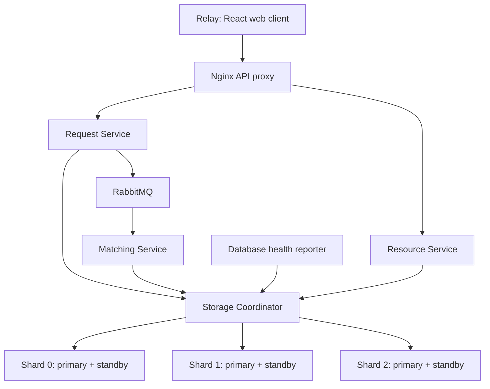
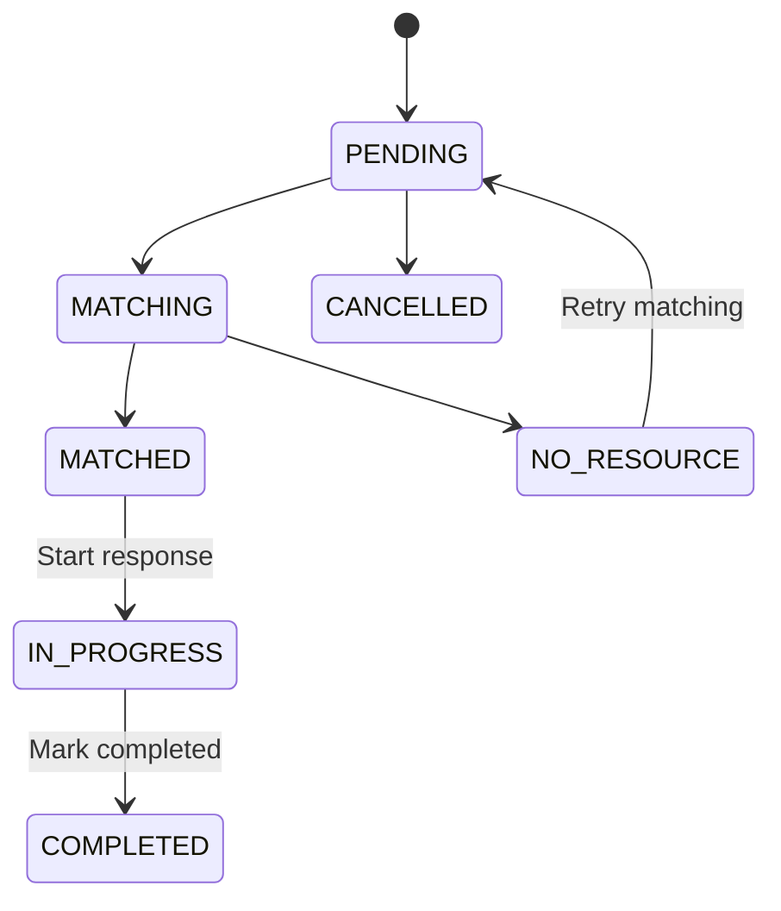
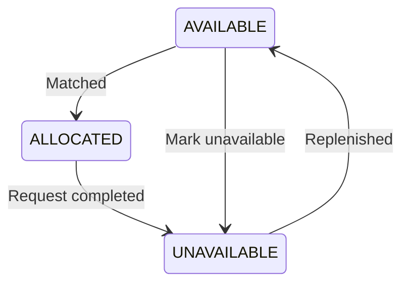

# Emergency Response Matching

A distributed emergency-assistance coordination system that connects requests for **food, water, medicine, transport and shelter** with suitable available resources. The web interface is named **Relay**.

The project demonstrates microservices, asynchronous messaging, database sharding, replication, concurrent allocation and recovery using Docker and Kubernetes. It is intended for local academic demonstrations with synthetic data.

## Contents

- [What the system does](#what-the-system-does)
- [Architecture](#architecture)
- [Technology stack](#technology-stack)
- [Matching and status rules](#matching-and-status-rules)
- [Data storage and reliability](#data-storage-and-reliability)
- [Repository structure](#repository-structure)
- [Run with Docker Compose](#run-with-docker-compose)
- [Run with Kubernetes](#run-with-kubernetes)
- [Walk through the website](#walk-through-the-website)
- [REST API](#rest-api)
- [Build and test](#build-and-test)
- [Troubleshooting](#troubleshooting)
- [Limitations](#limitations)

## What the system does

- Registers resources with a type, location, description and availability.
- Creates assistance requests with a unique ID, location, details and creation time.
- Persists requests before publishing matching events through RabbitMQ.
- Finds eligible resources by type, availability and geographic distance.
- Guards allocations so one resource cannot serve two active assignments.
- Tracks a request from submission through matching and completion.
- Supports retrying an unmatched request after suitable supply becomes available.
- Routes records across three independent database shards through a coordinator.
- Uses a primary and standby for each shard in the Kubernetes deployment.
- Displays database-member health, shard record counts and unpublished events in the Operations view.

The browser refreshes every five seconds. Request and resource lists show the most recent 200 records; the API supports pagination for older records.

## Architecture



| Component | Responsibility |
| --- | --- |
| Frontend | Request/resource forms, status actions, search and operations dashboard |
| Request Service | Public request APIs, manual matching triggers and outbox publication |
| Resource Service | Public resource registration, lookup, listing and availability changes |
| Matching Service | RabbitMQ consumption, candidate ranking, allocation workflow and interrupted-work recovery |
| Storage Coordinator | Shard routing, database transactions, guarded state changes and topology APIs |
| RabbitMQ | Durable asynchronous event delivery and dead-letter queue |
| PostgreSQL | Requests, resources, assignments and transactional outbox records |
| CloudNativePG | PostgreSQL replication, primary promotion and member recovery in Kubernetes |
| Health reporter | Member-specific health and role observations sent to the coordinator |

There are **three business microservices and one storage coordinator**. Business services do not connect directly to the application databases. The frontend accesses public HTTP APIs; physical shard locations are hidden from clients.

### Compose versus Kubernetes

| Deployment | Database topology | Purpose |
| --- | --- | --- |
| Docker Compose | Three independent PostgreSQL primaries | Convenient local development and integration testing |
| Kubernetes with kind | Three shards, each with a primary and standby: six database instances | Full replicated deployment, scaling and failure-recovery demonstrations |

Compose does not provide the final replicated database topology. Use Kubernetes when demonstrating replica reads, promotion and standby recovery.

## Technology stack

| Area | Implementation |
| --- | --- |
| Backend | Java 21, Spring Boot 4.1.2, Spring JDBC |
| Build and migrations | Maven 3.9.11 wrapper, Flyway |
| Frontend | React 19.1.1, TypeScript 5.9.2, Vite 7.3.7 |
| Frontend testing | Vitest |
| Databases | PostgreSQL 17.6 |
| Messaging | RabbitMQ 4.1.4 |
| Containers | Docker and Docker Compose |
| Orchestration | Kubernetes, kind, CloudNativePG 1.28.4 |
| HTTP serving | Nginx |
| CI | GitHub Actions |

Versions are recorded in the project build files, lockfile and deployment manifests.

## Matching and status rules

### Resource eligibility

A resource is eligible when all of these conditions hold:

1. Its type exactly matches the request type.
2. Its availability is `true` and its status is `AVAILABLE`.
3. Its geographic distance from the request is **at most 50 km** by default.

Distance uses the Haversine formula. Candidates are ordered by distance, with the resource UUID breaking equal-distance ties. The radius is an implementation choice and is configurable through the matching service's `emergency.match-radius-km` Spring property.

Each registration represents **one unit of capacity**. A description can identify a supply, volunteer, vehicle, shelter or organization. Quantity-based inventory, road travel times and route optimization are not implemented.

The optional `priority` field accepts `NORMAL`, `HIGH` or `CRITICAL`. It is stored as metadata; it does not override distance ordering or create priority-based scheduling.

### Request lifecycle



Matching states are controlled by the backend. Users can cancel only a `PENDING` request, start a `MATCHED` response and complete an `IN_PROGRESS` response. Invalid transitions are rejected. A retry of a `NO_RESOURCE` request queues another matching attempt; newly registered supply does not automatically retry every previously unmatched request.

### Resource lifecycle



An unassigned resource can be switched between available and unavailable. An allocated resource cannot be manually released through the availability endpoint. Completing its request makes it unavailable; an operator can explicitly make it available again when replenished.

## Data storage and reliability

Requests contain an ID, type, location, details, priority, status and timestamps. Resources contain an ID, type, location, description, availability, status and timestamps. The coordinator also stores assignment and outbox records.

### Sharding

IDs are UUIDs. The coordinator chooses the owning shard using Java signed-long arithmetic:

```java
Math.floorMod(id.getMostSignificantBits() ^ id.getLeastSignificantBits(), 3)
```

Resources are placed by their own IDs. Requests, their assignments and their outbox events are placed on the request's shard. All three shards use the same schema but hold distinct records. Candidate searches query every shard; an incomplete search is treated as unavailable rather than incorrectly concluding that no resource exists.

### Asynchronous processing

1. The coordinator saves the request and an outbox event in one transaction.
2. The Request Service leases pending outbox events and publishes them to RabbitMQ.
3. An event is marked published after broker confirmation.
4. A Matching worker claims the request and ranks eligible resources.
5. It persists its selected candidate before attempting the allocation.
6. Conditional database updates protect the resource from competing assignments.
7. The worker records the match and acknowledges the message.

Duplicate delivery is expected and handled through guarded state and allocation operations. Worker tokens fence obsolete owners. If a crash occurs after allocating a resource but before finalizing the request, the durable candidate pointer allows a new worker to resume that allocation. Expired workflows are scanned for recovery.

### Replication and recovery

CloudNativePG manages primary election, promotion and synchronization of returning members. Heartbeats report health; they do not authorize database promotion. Single-record request/resource reads can fall back to a standby and are explicitly labeled `readSource: REPLICA` and `potentiallyStale: true`. Matching decisions and writes use primary databases.

## Repository structure

```text
backend/
  common-contracts/       Shared payloads, HTTP client, validation and errors
  request-service/        Request APIs and outbox dispatcher
  resource-service/       Resource APIs
  matching-service/       Matching policy and message consumer
  storage-coordinator/    Shard routing, SQL operations and migrations
frontend/                 React interface, API client and Nginx configuration
infra/
  compose/                Development, local-build and testing configurations
  kubernetes/             Services, deployments, database clusters and policies
  health-reporter/        Database-member health reporting
scripts/                  Build, deployment, smoke, concurrency and recovery tests
docs/                     Architecture, API specification and operations guidance
.github/workflows/        Continuous integration
.env.example              Configuration template without real credentials
pom.xml                   Maven parent and module definitions
```

## Run with Docker Compose

### Prerequisites

- Git.
- Docker Desktop running Linux containers, or Docker Engine with the Compose plugin.
- Internet access for the first image and dependency downloads.
- Node.js 22 if you want to run verification scripts locally.

Java and Node are supplied by the Docker build stages for a container-only launch. Install Java 21 separately only when building the backend on the host.

### 1. Clone the repository

```powershell
git clone https://github.com/abhinavbhatia2006/emergency-response-matching.git
cd emergency-response-matching
```

Run subsequent commands from this directory.

### 2. Configure credentials

```powershell
Copy-Item .env.example .env
```

On Linux/macOS, use `cp .env.example .env`. Do not overwrite an existing configured `.env`.

Edit these values before starting:

| Variable | Purpose |
| --- | --- |
| `DB_USER` | Application database username |
| `DB_PASSWORD` | Database password |
| `RABBITMQ_USER` | Broker username |
| `RABBITMQ_PASSWORD` | Broker password |
| `INTERNAL_TOKEN` | Shared token protecting internal service calls; use a long random value |

Replace every placeholder password/token. Keep the variables consistent across services. The real `.env` is ignored by Git; only the template is committed.

### 3. Build and start

```powershell
docker compose --env-file .env -f infra/compose/compose.yaml up -d --build
```

The first build may take several minutes. Check startup with:

```powershell
docker compose --env-file .env -f infra/compose/compose.yaml ps
docker compose --env-file .env -f infra/compose/compose.yaml logs --tail 100
```

### 4. Open the application

Open **[http://localhost:8088](http://localhost:8088)**.

| Local endpoint | Purpose |
| --- | --- |
| `http://localhost:8088` | Website |
| `http://localhost:8088/api` | Public API base URL |
| `http://localhost:15672` | RabbitMQ management; sign in with `.env` broker credentials |
| `localhost:5672` | RabbitMQ AMQP |
| `localhost:5433`, `5434`, `5435` | PostgreSQL shards 0, 1 and 2 |

These Compose ports bind to loopback. Backend service ports remain inside the container network unless the testing override is enabled.

### 5. Stop or restart

```powershell
# Stop containers and remove their network; named data volumes are retained.
docker compose --env-file .env -f infra/compose/compose.yaml down

# Start again with the existing data.
docker compose --env-file .env -f infra/compose/compose.yaml up -d
```

Do not add `-v` unless you intend to delete the stored database and broker volumes.

## Run with Kubernetes

Install **kind**, **kubectl** and **PowerShell**, and keep Docker running. The supplied deployment script targets the local `kind-emergency` context.

### 1. Build the application images

Configure `.env` as above, then run:

```powershell
docker compose --env-file .env -f infra/compose/compose.yaml build
```

If the Compose stack is running, stop it to avoid competing for memory and port 8088:

```powershell
docker compose --env-file .env -f infra/compose/compose.yaml stop
```

### 2. Create the cluster and deploy

```powershell
kind create cluster --config infra/kubernetes/kind.yaml
./scripts/deploy-kubernetes.ps1
```

Create the cluster only once; skip the first command if the `emergency` kind cluster already exists. The deployment script installs CloudNativePG, creates Secrets from `.env`, provisions the three replicated shards and RabbitMQ, loads local application images, and deploys the services and health reporter.

### 3. Verify readiness

```powershell
kubectl --context kind-emergency -n emergency get deployments
kubectl --context kind-emergency -n emergency get pods
kubectl --context kind-emergency -n emergency get clusters
```

Each database cluster should have two ready instances. Initial startup can take several minutes.

### 4. Forward the website

```powershell
kubectl --context kind-emergency -n emergency port-forward svc/frontend 8088:8080
```

Keep this terminal open and visit [http://localhost:8088](http://localhost:8088). Restart the forward if it closes or the selected frontend pod is replaced. Pressing Ctrl+C stops the forward, not the application pods.

### 5. Demonstrate scaling

```powershell
kubectl --context kind-emergency -n emergency scale deployment/matching-service --replicas=3
kubectl --context kind-emergency -n emergency rollout status deployment/matching-service
```

Multiple workers share the matching queue and rely on guarded allocations to prevent double booking. See the [runbook](docs/runbook.md) for controlled pod-failure and replica-recovery demonstrations.

## Walk through the website

1. **Resources → Add resource:** choose `WATER`, enter a location label and coordinates, add a description, and leave availability checked.
2. **Requests → New request:** choose `WATER`, enter a nearby location within 50 km, and describe the need.
3. Wait for asynchronous processing. A suitable request changes to `MATCHED` and displays its assigned resource ID.
4. Select **Start response** to enter `IN_PROGRESS`.
5. Select **Mark completed** to enter `COMPLETED`. The resource becomes unavailable.
6. To demonstrate shortage handling, create another request without suitable available supply. It settles at `NO_RESOURCE`.
7. Register or replenish a suitable resource, then select **Retry matching** on the unmatched request.
8. Open **Operations** to inspect shard distribution and database health observations.

Search filters the loaded records by ID, type, location, status and details/description. The dashboard counters describe the loaded view, not an unrestricted total of the entire database.

## REST API

Public endpoints use the base URL `http://localhost:8088/api` through Nginx. Send request bodies as JSON with `Content-Type: application/json`.

| Method | Path | Purpose | Success |
| --- | --- | --- | --- |
| `POST` | `/requests` | Create a request and queue matching | `201` |
| `GET` | `/requests` | List requests across shards | `200` |
| `GET` | `/requests/{id}` | Read a request | `200` |
| `PUT` | `/requests/{id}/status` | Cancel, start or complete a request | `200` |
| `POST` | `/resources` | Register a resource | `201` |
| `GET` | `/resources` | List resources; optional `type` filter | `200` |
| `GET` | `/resources/{id}` | Read a resource | `200` |
| `PUT` | `/resources/{id}/status` | Change unassigned resource availability | `200` |
| `POST` | `/match/{requestId}` | Request a matching retry or report current state | `200` |
| `GET` | `/ops/topology` | Read topology and shard statistics | `200` |

List endpoints accept `offset` from 0 to 10000 and `limit` from 1 to 200; defaults are 0 and 50. IDs are UUIDs and timestamps use UTC ISO-8601. Matching triggers return before a new assignment is necessarily available; retrieve the request to observe its eventual status.

### Register a resource

`POST /api/resources`

```json
{
  "type": "WATER",
  "location": {
    "label": "Synthetic volunteer hub",
    "latitude": 12.973,
    "longitude": 77.596
  },
  "description": "Synthetic drinking-water supply",
  "availability": true
}
```

### Create a request

`POST /api/requests`

```json
{
  "type": "WATER",
  "location": {
    "label": "Synthetic relief camp",
    "latitude": 12.9716,
    "longitude": 77.5946
  },
  "details": "Synthetic drinking-water request",
  "priority": "NORMAL"
}
```

### Update a status

`PUT /api/requests/{id}/status`

```json
{"status": "IN_PROGRESS"}
```

For an unassigned resource, use `AVAILABLE` or `UNAVAILABLE` at `/api/resources/{id}/status`.

### Validation and errors

Latitude must be between -90 and 90; longitude between -180 and 180. Location labels are required and limited to 200 characters. Request details are required and limited to 2000 characters; optional resource descriptions have the same maximum length.

The API uses `400` for invalid input, `404` for missing records/routes, `405` for unsupported methods, `406`/`415` for unsupported formats, `409` for state conflicts and `503` for temporary service/storage unavailability. Error responses omit SQL, credentials and stack traces. During failover, the proxy can also return a gateway error before the backend responds.

See the [API contract](docs/api/contract.md) and [OpenAPI specification](docs/api/openapi.yaml) for additional details.

## Build and test

### Backend

Install Java 21 and set `JAVA_HOME` when building outside Docker. The Maven wrapper downloads Maven if necessary.

```powershell
./scripts/build.ps1
```

On Linux/macOS:

```bash
./mvnw verify
```

The backend tests cover shard routing, matching eligibility/distance and error status handling. `build.ps1 -Offline` is intended only for an already populated local dependency cache.

### Frontend

Install Node.js 22, then run:

```powershell
npm --prefix frontend ci
npm --prefix frontend test
npm --prefix frontend run build
```

### Running-system tests

Run against local synthetic data. These scripts create records, and failure drills deliberately interrupt project components. Run them sequentially.

| Script | Checks |
| --- | --- |
| `scripts/smoke.mjs` | Creation, asynchronous matching, lookup, lifecycle and input errors |
| `scripts/load-test.mjs` | Concurrent requests competing for one resource; exactly one winner |
| `scripts/integration.mjs` | Competing allocations, cross-shard crash recovery, stale tokens, outbox and shard distribution |
| `scripts/broker-recovery.mjs` | Persistence during a Compose broker outage and matching after recovery |
| `scripts/backup-restore.mjs` | Per-shard backups restored into separate test databases |
| `scripts/kubernetes-drills.mjs` | Primary promotion, standby catch-up, worker scaling and pod replacement |
| `scripts/kubernetes-read-fallback.mjs` | Explicit replica read when a primary service is unreachable |
| `scripts/kubernetes-observability.mjs` | Heartbeats, metrics, internal token enforcement, dead-lettering and duplicate events |

For basic checks against either deployment:

```powershell
$env:BASE_URL = 'http://localhost:8088/api'
node scripts/smoke.mjs
node scripts/load-test.mjs
```

For the Compose integration tests, first enable the localhost coordinator testing port:

```powershell
docker compose --env-file .env -f infra/compose/compose.yaml -f infra/compose/testing.yaml up -d
node scripts/integration.mjs
node scripts/broker-recovery.mjs
node scripts/backup-restore.mjs
```

Kubernetes tests require additional preparation described in the [operations runbook](docs/runbook.md). In particular, run the Kubernetes smoke test with its documented evidence name before observability checks. Generated reports are stored locally under the Git-ignored `docs/evidence/` directory.

### Continuous integration

The GitHub Actions workflow runs on pushes and pull requests. It builds and tests the backend and frontend, starts the Compose stack, and executes smoke, concurrency, integration, broker-recovery and backup-restore checks. It uploads generated verification artifacts. Check the repository's Actions page for the result of a particular run; the presence of a workflow is not proof that it passed.

## Troubleshooting

| Symptom | Check |
| --- | --- |
| Website does not open | Confirm Docker is running and the Compose frontend is up, or restart the Kubernetes port forward |
| Port 8088 is already in use | Stop the competing frontend/forward, or forward Kubernetes as `8089:8080` and use port 8089 |
| Initial `502`/`503` response | Check readiness and logs; Java services and database migrations may still be starting |
| Request shows `NO_RESOURCE` | Check exact type, availability, coordinates and the 50 km radius, then explicitly retry |
| Resource cannot be made available | An active assignment owns it; complete the associated response first |
| Database authentication fails after editing `.env` | Existing PostgreSQL volumes retain their initialized credentials; changing `.env` alone does not change those accounts |
| Kubernetes image is missing | Build the Compose images before running the deployment script |
| Failure drill reports a timeout | Check pod status, logs and available machine resources; verify the drill restored the affected components |

Useful commands:

```powershell
docker compose --env-file .env -f infra/compose/compose.yaml logs --tail 100 matching-service
kubectl --context kind-emergency -n emergency get pods
kubectl --context kind-emergency -n emergency logs deployment/matching-service --tail=100
```

## Limitations

- This is a local academic application. Public APIs have no user authentication or ownership model; do not expose it as a real emergency service.
- One coordinator and one RabbitMQ instance are availability bottlenecks. Outbox persistence helps recovery but does not eliminate interruptions.
- PostgreSQL replication is asynchronous. Recently committed data can be lost if a primary fails before replication catches up.
- A single-node kind cluster demonstrates member/pod recovery, not resilience to failure of the laptop or its disk.
- Replica reads may be stale. Lists, candidate searches and writes require the relevant primaries.
- Straight-line distance is not road distance or travel time. Capacity is one per resource registration.
- The supplied NetworkPolicy needs a network-policy-capable CNI for enforcement; default kindnet does not enforce it.
- Passing tests establishes observed behavior for those cases, not absolute bug-freedom or production availability.

Read [security and operational limits](docs/security-and-limits.md), [architecture](docs/architecture.md), and the [runbook](docs/runbook.md) for further detail.
