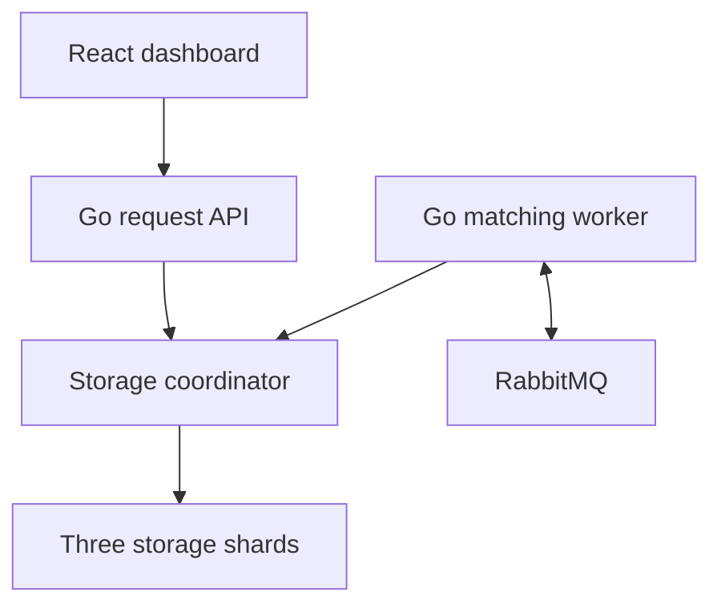

# Sahara

Sahara is a cloud computing coursework project that matches emergency assistance requests with available resources. The React dashboard lets you register resources, submit and track requests, and view locations on a map. The Go backend processes matches asynchronously through RabbitMQ and stores records across three replicated PostgreSQL-backed shards.

## What you can do

- Request or offer food, water, medicine, transportation, or shelter.
- Pin a request or resource on the map. Sahara picks the nearest available resource of the same type within a configurable straight-line radius of 50 km by default.
- Follow a request from pending to matched and completed, or cancel it. The backend commits the assignment and resource reservation together to prevent double booking.
- Open **Shard details** to inspect record counts, node readiness, and heartbeats. The demonstration scripts exercise replica failover, recovery, and Kubernetes scaling.

## Requirements

| Task | Install locally |
| --- | --- |
| Run with Docker Compose | Git, Docker Engine with Compose v2, and a browser. On Windows, start Docker Desktop in Linux container mode. [Docker Desktop for Windows](https://docs.docker.com/desktop/setup/install/windows-install/) |
| Run the numbered Windows scripts | PowerShell and Python 3 for the smoke tests and first-time credential setup. The scripts accept `python` or `py -3`. |
| Run the Kubernetes demonstration | Docker, `kind`, and `kubectl`. The manifests use eight 1 GiB persistent volume claims and a default StorageClass. [kind Quick Start](https://kind.sigs.k8s.io/docs/user/quick-start/) |
| Run source-level checks | Go 1.25 or newer for the backend. Node.js 22.12 or newer and npm for the frontend. [Vite requirements](https://vite.dev/guide/) |

Docker builds the Go and React components and starts PostgreSQL 17 and RabbitMQ 4 as containers. The first build needs internet access to download base images and package dependencies.

## Run locally with Docker Compose

### 1. Clone the repository

```sh
git clone https://github.com/abhinavbhatia2006/emergency-response-matching.git
cd emergency-response-matching
```

### 2. Build and start the application

**Windows PowerShell.** Run the setup script from the repository root.

```powershell
.\scripts\01-setup-docker.ps1
```

On a fresh checkout the script generates credentials in `.env` and sets the host port to `18080`. It reuses an existing `.env`, builds the images, waits for the stack to become healthy, and prints the dashboard URL.

**Manual setup.** In a Bash-compatible shell, create the local configuration if it does not already exist.

```sh
test -f .env || cp .env.example .env
```

On a fresh setup, edit `.env` and set distinct random alphanumeric values for `INTERNAL_TOKEN`, `POSTGRES_PASSWORD`, and `RABBITMQ_PASSWORD`. To generate one value at a time, run `python3 -c 'import secrets; print(secrets.token_hex(32))'`. Keep `.env` private and reuse its credentials with existing data volumes. Then start the stack.

```sh
docker compose config --quiet
docker compose up -d --build --wait --wait-timeout 300
docker compose ps
```

### 3. Open the dashboard and verify startup

```sh
docker compose port request-api 8080
```

Open the address printed by that command in your browser. A fresh PowerShell setup uses [http://127.0.0.1:18080](http://127.0.0.1:18080). The manual setup uses [http://127.0.0.1:8080](http://127.0.0.1:8080) unless you set a different `APP_PORT`. Add `/readyz` to the address to check for `{"status":"ready"}`.

For a quick walkthrough, use **Add resource** to register an available shelter resource. Use **New request** to request shelter and place its pin near the resource. Refresh the request list to see the worker's assignment and the distance. Open **Map** to see the pins or **Shard details** to see the storage nodes.

### Configuration and shutdown

| Setting | Purpose |
| --- | --- |
| `APP_PORT` | Host port for the Docker Compose dashboard. The API listens on port `8080` inside the container. |
| `MAX_MATCH_DISTANCE_METERS` | Maximum matching distance in Compose. Defaults to `50000` metres. See the [geographic matching guide](docs/geographic-matching.md) for the Kubernetes setting. |
| `INTERNAL_TOKEN`, `POSTGRES_PASSWORD`, `RABBITMQ_PASSWORD` | Required credentials for service communication, PostgreSQL, and RabbitMQ. |

Run `docker compose stop` to stop the containers and keep the data. Resume with `docker compose start --wait --wait-timeout 300`. If startup fails, run `docker compose ps` and `docker compose logs --tail 100 coordinator request-api matching-worker`. [Docker Compose guide](docs/docker.md)

## Run on Kubernetes

After the Docker setup above has built the images, run the following from the repository root in Windows PowerShell. The setup script requires Docker's Linux engine to use cgroup v2. It creates or reuses a Kubernetes 1.37.0 `kind` cluster named `sahara-demo-v137`, loads the images, deploys to the `response-matching` namespace, and waits for the workloads and persistent volume claims.

```powershell
.\scripts\11-setup-kubernetes.ps1
```

In a second PowerShell window at the repository root, keep the port-forward running.

```powershell
.\scripts\12-forward-kubernetes.ps1
```

Open [the Kubernetes dashboard](http://127.0.0.1:18082). Run `.\scripts\13-test-kubernetes-baseline.ps1` in the first window to verify readiness and a deployed matching workflow. For direct `kind` and `kubectl` commands in Bash or PowerShell, see the [Kubernetes deployment guide](docs/kubernetes.md).

## Architecture



The API stores each new request and an outbox job together. The matching worker publishes the job to RabbitMQ, consumes it, and attempts an assignment. The coordinator uses a PostgreSQL journal to commit versioned updates and replicate them to the affected shards. Each shard has a primary and replica, each backed by its own PostgreSQL database. Docker Compose and Kubernetes run the same application components.

## Tests and demonstration

| Check | What it covers |
| --- | --- |
| [Go checks](.github/workflows/test.yml) | Validation, matching logic, concurrent reservation, storage, and messaging. Run `go vet ./...` and `go test ./...` locally. CI supplies PostgreSQL and RabbitMQ for tests that use `TEST_DATABASE_URL` and `TEST_RABBITMQ_URL`. |
| [Frontend checks](.github/workflows/frontend.yml) | Dashboard behavior with Vitest and a production build. Run `npm ci`, `npm test`, and `npm run build` from `web/`. |
| [Deployment checks](.github/workflows/deployment.yml) | End-to-end matching in Docker Compose, geographic selection, shard placement, failover, recovery, and Kubernetes scaling and Pod replacement. |

## Repository layout

| Path | Contents |
| --- | --- |
| [`cmd/`](cmd/) | Request API, matching worker, coordinator, and storage-node entry points |
| [`internal/`](internal/) | Application logic, messaging, coordination, and persistence |
| [`web/`](web/) | React dashboard and frontend tests |
| [`deploy/kubernetes/`](deploy/kubernetes/) | Kubernetes manifests |
| [`scripts/`](scripts/) | Smoke tests, deployment checks, and numbered demonstration scripts |
| [`docs/`](docs/) | Setup and design documentation, including the [public API reference](docs/application.md) |

Sahara is intended for local coursework demonstrations. It uses a single storage coordinator and a local API without user authentication.

## License

[MIT](LICENSE)
