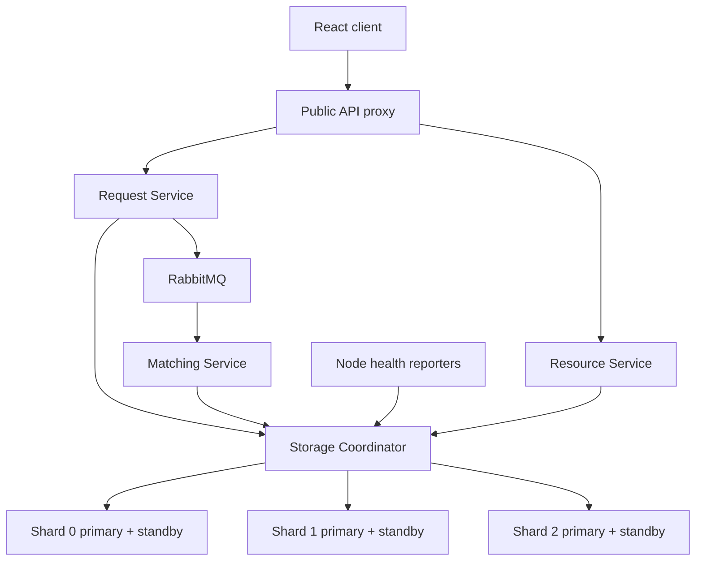

# Architecture

## Responsibilities and boundaries

| Component | Owns | Access |
| --- | --- | --- |
| Frontend | Forms, status display, demo views | Public REST only |
| Request Service | Request lifecycle API and outbox dispatch | Coordinator HTTP, RabbitMQ publish |
| Resource Service | Resource registration, listing, status API | Coordinator HTTP |
| Matching Service | Eligibility, distance ranking, saga orchestration, reconciliation | Coordinator HTTP, RabbitMQ consume |
| Storage Coordinator | UUID routing, SQL transactions, candidate aggregation, topology | Three shard connection pools |
| PostgreSQL shards | Durable records, outbox, assignments and deduplication | Coordinator; controlled migrations/admin tooling |
| RabbitMQ | Asynchronous event delivery | Request publisher, Matching consumer |
| CNPG / health reporters | Database roles, replication, recovery / observed health | Kubernetes and actual database members |

Exactly three business services and one infrastructure coordinator. The coordinator executes atomic storage primitives; matching policy stays in Matching Service. The Request Service dispatches outbox events through coordinator lease/publish-marker endpoints without JDBC access.

## Topology



Local Compose initially has three primaries. Final Kubernetes has three independent CNPG clusters with two instances each. Three copies of the same dataset would be replication alone and would not satisfy sharding.

## Request creation and matching

```mermaid
sequenceDiagram
  participant U as Client
  participant R as Request Service
  participant C as Coordinator
  participant D as Request shard
  participant Q as RabbitMQ
  participant M as Matching Service
  participant S as Resource shard
  U->>R: POST /requests
  R->>C: Create request and outbox
  C->>D: One transaction: request + event
  D-->>C: Commit
  C-->>R: Created
  R-->>U: 201 PENDING
  R->>C: Lease pending events
  R->>Q: Publish event with stable event ID
  Q-->>R: Publisher confirm
  R->>C: Mark published using lease ownership
  Q->>M: Deliver (duplicates possible)
  M->>C: Claim request workflow; read all candidate shards
  M->>C: Persist selected candidate with worker token
  C->>D: Commit durable candidate pointer
  M->>C: Commit selected candidate
  C->>D: Lock request and validate current token
  C->>S: Conditional allocation, idempotent for same request
  C->>D: Persist completed assignment
  M->>Q: Ack after durable handling
```

The selected candidate is committed before the cross-shard write. If the resource allocation commits but the request transaction fails, a new worker reads the same candidate and resumes the idempotent allocation. The request row lock and current lease token serialize workers. The integration script exercises this crash window and rejects an old token. This is resume-forward recovery; no worker releases a resource merely because a lease expired. Deduplication alone does not make a cross-shard workflow atomic.

## Database failure and recovery

```mermaid
sequenceDiagram
  participant H as Health reporter
  participant C as Coordinator
  participant P as Primary
  participant O as CNPG operator
  participant S as Standby
  H->>P: Member-specific readiness/role probe
  P--xH: Unreachable
  H->>C: Unhealthy or heartbeat expires
  C->>C: Avoid unhealthy member; bound retries
  O->>S: Safely promote eligible standby
  O->>C: Write service resolves to new primary
  C->>S: Retry safe operation with idempotency
  P->>O: Failed member returns
  O->>P: Rejoin and synchronize
  H->>C: Report recovered role and lag
```

CNPG owns election, promotion and fencing. A heartbeat never authorizes the coordinator to promote a database. Read fallback may be stale and is restricted to read-only views; reservations, finalization and authoritative state checks use the current primary. Failure and promotion can temporarily return 503. Asynchronous replication may lose recent committed data after primary loss; measure and disclose this in the final drill.

## Data and correctness invariants

- UUID v4 IDs are generated before insert. Shard is `floorMod(msb XOR lsb, 3)` using Java signed long arithmetic. Routing must be identical across restarts.
- Requests, request-owned assignments, outbox events live on the request owner shard. Resources live on their own independently determined shard.
- No cross-database foreign key is assumed. Durable saga state and reconciliation resolve partial progress.
- Resource capacity is one. `availability == (status == AVAILABLE)`; unavailable resources cannot be reserved. Reservation and state updates use conditional SQL.
- Exact resource type and coordinates are required. Haversine distance, a configured radius, distance ordering, then UUID tie-breaking define deterministic selection.
- Candidate search requires responses from all three shards. A failed shard produces a retryable unavailable result, never a false NO_RESOURCE verdict.
- Request creation and its initial outbox event commit in one database transaction. Publish marking occurs only after confirmed, routed delivery; replay is expected.
- Expose internal APIs only within the application network. Public errors omit connection strings, stack traces and credentials.

## Lifecycle baseline

Requests: `PENDING -> MATCHING -> MATCHED -> IN_PROGRESS -> COMPLETED`; `MATCHING -> NO_RESOURCE`; manual retry `NO_RESOURCE -> PENDING`; cancellation is initially allowed only from PENDING with a guarded race against matching. Broader cancellation waits for an explicit compensation policy.

Resources: `AVAILABLE -> ALLOCATED -> UNAVAILABLE`. A committed candidate pointer serves as durable assignment intent; a separate timed RESERVED state is not needed by this implementation. Completion consumes capacity for version 1; an operator can explicitly make an unassigned resource available again. Allocated resources cannot be freed through an arbitrary public status update. The schema reserves RESERVED for a future richer workflow, but current matching does not use it.

## Known limitations and deferred decisions

One running coordinator is a temporary availability and throughput bottleneck. Static three-shard mapping needs explicit data migration if shard count changes. Straight-line distance is not travel time. The default matching radius is 50 km; worker leases last 60 seconds.
